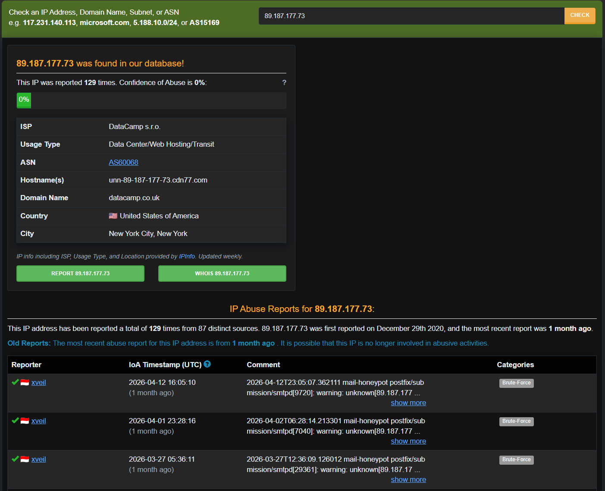
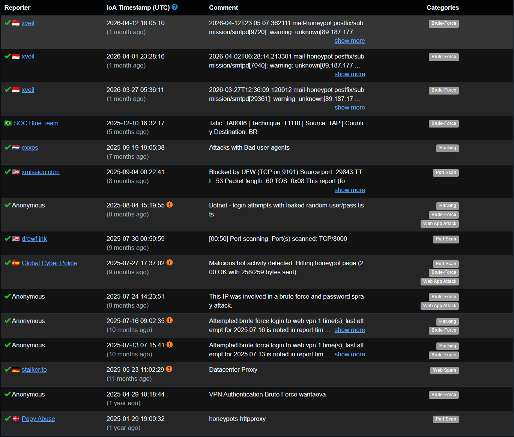
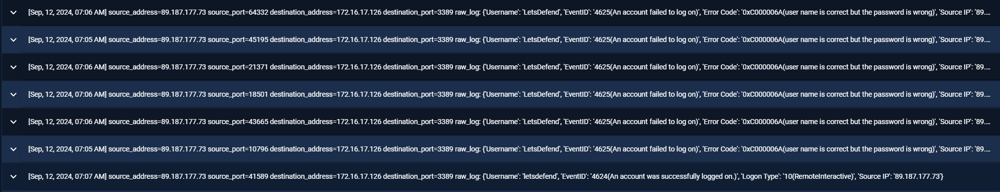
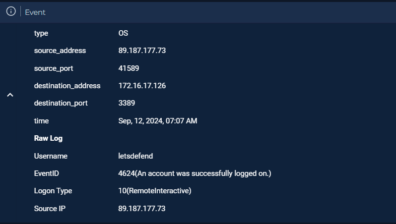
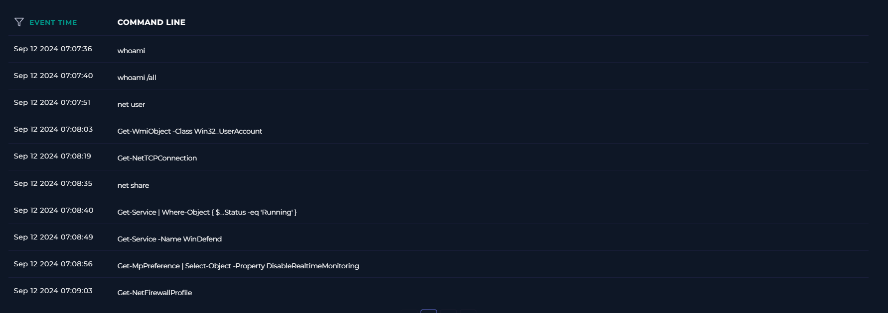
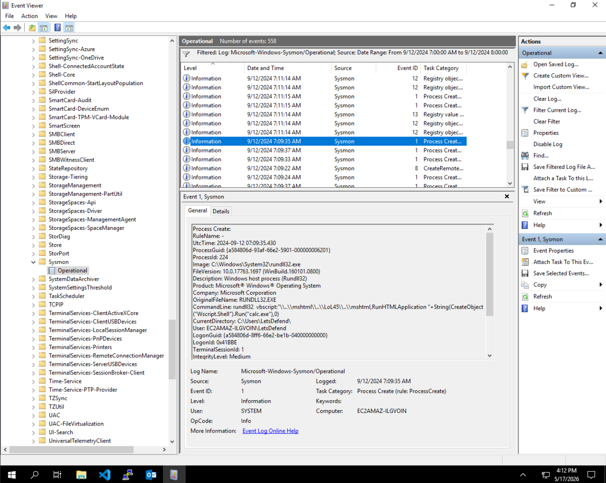
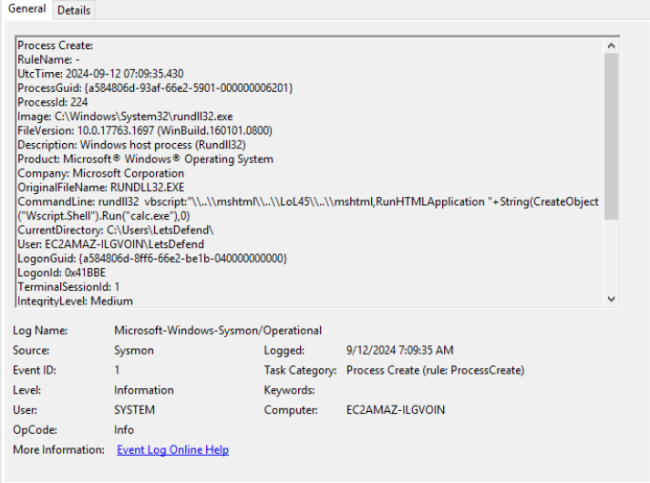
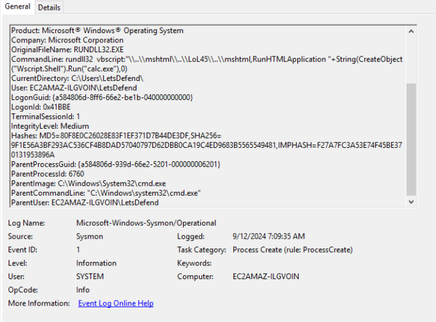
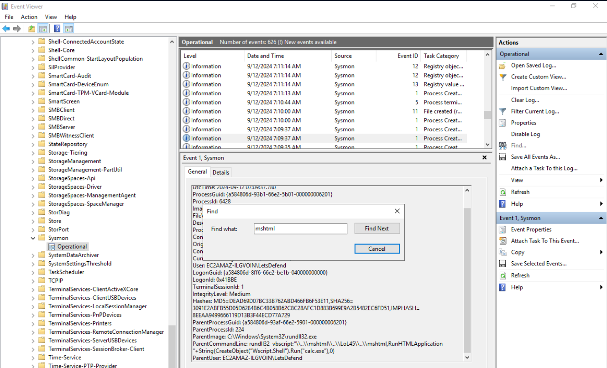
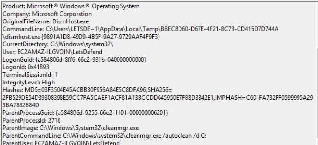

# Windows Defender Evasion Attempt

---

**Platform:** Let's Defend — SOC321
**Alert:** Windows Defender Evasion Attempt
**Hostname:** Elenora (172.16.17.126)
**Date:** 2024-09-12

---

# Summary

This is the investigation of a **Windows Defender Evasion** alert raised during a Let's Defend SOC practice scenario. 


## Alert Overview

| Field | Value |
|---|---|
| Event ID | 299 |
| Rule | SOC321 — Windows Defender Evasion Attempt |
| Severity | Incident Responder |
| Hostname | Elenora |
| OS | Windows 10 (Client) |
| Destination IP | 172.16.17.126 |
| Process Name | RUNDLL32.EXE |
| EDR/AV Action | Not Detected |
| Triggered Command | `rundll32 vbscript:"\..\mshtml\..\LoL45\..\mshtml,RunHTMLApplication "+String(CreateObject("Wscript.Shell").Run("calc.exe"),0)` |


## 1. Trigger Reason


`rundll32.exe` combined with `vbscript:` is a well-known attaker technique "LOLBIN" for fileless execution and application-control/EDR bypass often used to bypass endpoint detection and application control mechanisms. This combination alone is enough to fire defense-evasion detections and this behavior commonly triggers security alerts due to its association with **defense evasion and fileless execution**.






- **Attacker IP:** 89.187.177.73
- **ISP:** DataCamp s.r.o. (USA)
- **Threat Intel:** Tagged as **VPN** usage in VirusTotal
- **Destination Host:** 172.16.17.126 
- **Target Username:** LetsDefend
---

## 2. RDP Time-line

On **Sep 12, 2024, 07:04 AM**, RDP brute-force activity began against `172.16.17.126` (Elenora), targeting the `LetsDefend` account.

- 10 failed attempts, all `EventID 4625`
-  11th attempt at **07:07 AM** succeeds → `EventID 4624`, `LogonType 10 (RemoteInteractive)`.



On the total of 11 attempts to login, the 11 th attempt succeeds at morning 07:07 AM.




This confirms the attacker obtained **valid interactive access** to a Windows 10 **user workstation**, not a server or scheduled task.

---

## 3. Post-Compromise Recon

Immediately after login, the attacker began executing series of series of commands as it seen as scripted-looking but manually-paced sequence of recon commands over cmd/PowerShell:

Commands Executed by  the attacker with the timeline:

| Time | Command |
|---|---|
| 07:07:36 | `whoami` |
| 07:07:40 | `whoami /all` |
| 07:07:51 | `net user` |
| 07:08:03 | `Get-WmiObject -Class Win32_UserAccount` |
| 07:08:19 | `Get-NetTCPConnection` |
| 07:08:35 | `net share` |
| 07:08:40 | `Get-Service \| Where-Object { $_.Status -eq 'Running' }` |
| 07:08:49 | `Get-Service -Name WinDefend` |
| 07:08:56 | `Get-MpPreference \| Select-Object -Property DisableRealtimeMonitoring` |
| 07:09:03 | `Get-NetFirewallProfile` |




---

## 4. LOLBIN Execution

With recon done, the attacker tested fileless execution:

**1st run — 07:09:22 AM**
```
rundll32 vbscript:"\..\mshtml\..\mshtml\..\mshtml,RunHTMLApplication "+String(CreateObject("Wscript.Shell").Run("calc.exe"),0)
```

**2nd run (obfuscated) — 07:09:35 AM**
```
rundll32 vbscript:"\..\mshtml\..\LoL45\..\mshtml,RunHTMLApplication "+String(CreateObject("Wscript.Shell").Run("calc.exe"),0)
```


Here the attacker use the calc.exe as the proof of execution to check where the script execution is allowed or whether it block by the EDR for the malicious behavior.

---

## 5. Process Creation Evidence 




`rundll32.exe` process creation detail:

```
Image: C:\Windows\System32\rundll32.exe
OriginalFileName: RUNDLL32.EXE
CommandLine: rundll32 vbscript:"\..\mshtml\..\LoL45\..\mshtml,RunHTMLApplication "+String(CreateObject("Wscript.Shell").Run("calc.exe"),0)
CurrentDirectory: C:\Users\LetsDefend\
User: EC2AMAZ-ILGVOIN\LetsDefend
IntegrityLevel: Medium
```



Hashes and parent process:

```
MD5=9F0E80EC26028E83F1EF371D7B44DE3DF
SHA256=9F1E56A3BF293AC536CF4B8DAD57040797D62DBB0CA19C4ED9683B5565549481
IMPHASH=F27A7FC3A53E74F45BE370131953896A

ParentImage: C:\Windows\System32\cmd.exe
ParentCommandLine: "C:\Windows\system32\cmd.exe"
ParentUser: EC2AMAZ-ILGVOIN\LetsDefend
```



This confirms the execution was **user-initiated and interactive** and not a system-generated one.

Searching the Sysmon log for the string `mshtml` also surfaces the **child process** that `rundll32.exe` itself spawned (`calc.exe`), confirming the `Wscript.Shell.Run()` call actually fired end-to-end:



---

## 6. Secondary Event Execution

A separate process creation was observed in the same log window, unrelated to the rundll32 chain — `DismHost.exe` spawned from `cleanmgr.exe /autoclean /d C:` at High integrity:

```
OriginalFileName: DismHost.exe
CommandLine: C:\Users\LETSDE~1\AppData\Local\Temp\BBEC8D60-D67E-4F21-8C73-CD415D7D744A\dismhost.exe {9891A1D8-49D9-4B5F-9A27-9729AAF4F9F3}
ParentImage: C:\Windows\System32\cleanmgr.exe
ParentCommandLine: C:\Windows\System32\cleanmgr.exe /autoclean /d C:
```



This is Disk Cleanup's own normal `/autoclean` behavior and is called out here only because it appeared in the same filtered window — it is **not** attributed to the attacker.

---

## 7. Windows Defender Status & Detection

Post-incident checks confirmed Windows Defender was active the whole time:

- `Get-Service -Name WinDefend` → **Running**
- `Get-MpPreference | Select DisableRealtimeMonitoring` → **False** (real-time protection on)

Despite the alert's own "EDR/AV Action: Not Detected" field, running `Get-MpThreatDetection` showed that **Microsoft Defender did in fact flag the activity**, at **07:09:22 AM** — the same moment as the first `rundll32` execution. So detection existed; it just didn't block/auto-remediate, which is exactly why the activity still reached the SOC as an alert rather than being silently stopped.

---

## 8. Evidence Clearance

At **07:11:15 AM**, two events logged back-to-back:

- `The event logging service has shutdown`
- `The system time was changed`

Both are classic attacker cleanup moves — disrupt logging and muddy the forensic timeline right after testing evasion capability.

---

# Attack Timeline

1. **07:04 AM** — RDP brute-force starts, `89.187.177.73` → `172.16.17.126` (Elenora).
2. **07:04–07:07 AM** — 10 failed RDP logons (`4625`, bad password / good username).
3. **07:07 AM** — Successful RDP logon (`4624`, `LogonType 10/RemoteInteractive`).
4. **07:07:36 AM** — Hands-on-keyboard recon begins (`whoami` onward).
5. **07:07:51–07:08:03 AM** — Local/domain user enumeration.
6. **07:08:19–07:08:35 AM** — Network connections + shares enumerated.
7. **07:08:40–07:09:03 AM** — Services, Defender status, firewall profile checked.
8. **07:09:22 AM** — First `rundll32` + `mshtml` LOLBIN execution (`calc.exe` proof-of-exec); Defender quietly logs detection in the background.
9. **07:09:35 AM** — Obfuscated second run (`..\LoL45\..`) to test signature evasion.
10. **07:11:15 AM** — Event logging service stopped + system time changed.

---

# Conclusion

**True Positive — confirmed compromise.**

- The attacker gained access through RDP using brute-forced credentials.
- They checked users, privileges, accounts, network connections, shared folders, running services, and security settings.
- They tested a fileless execution technique using `rundll32.exe` and `mshtml.dll` to launch `calc.exe`, both normally and with obfuscation.
- No malware was saved to disk. The activity appears to be testing security detection and execution capabilities.
- Finally, they stopped a logging service and changed the system time, possibly to hide their activities.

